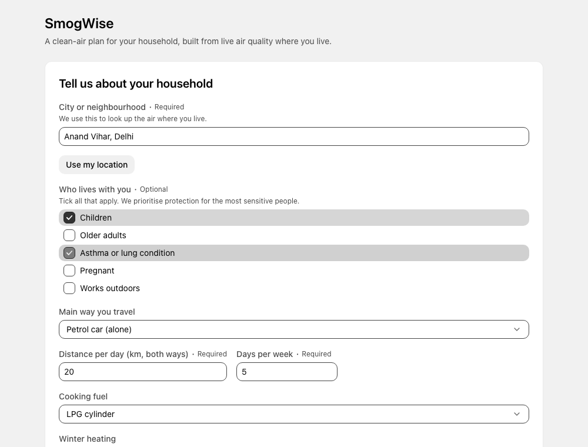
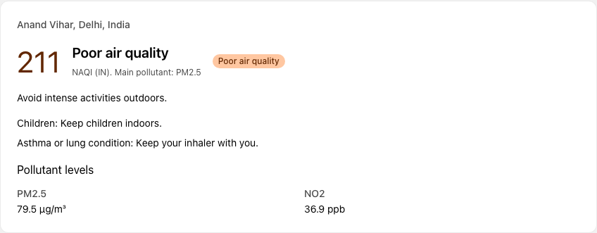
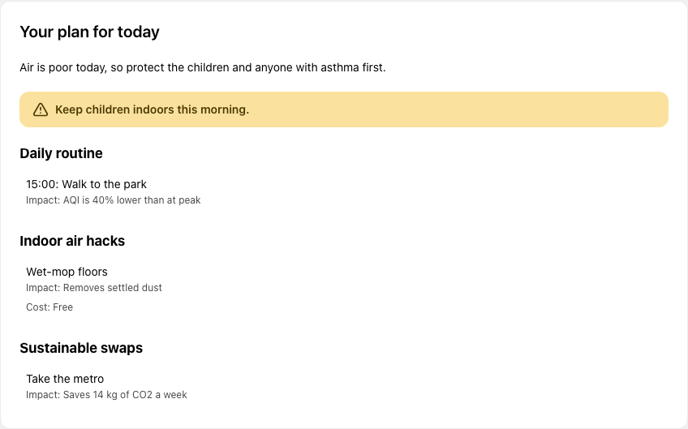
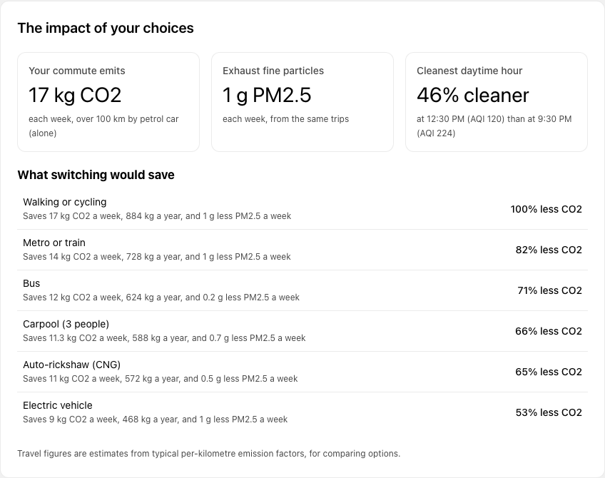
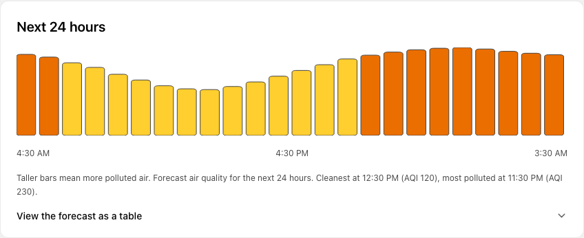
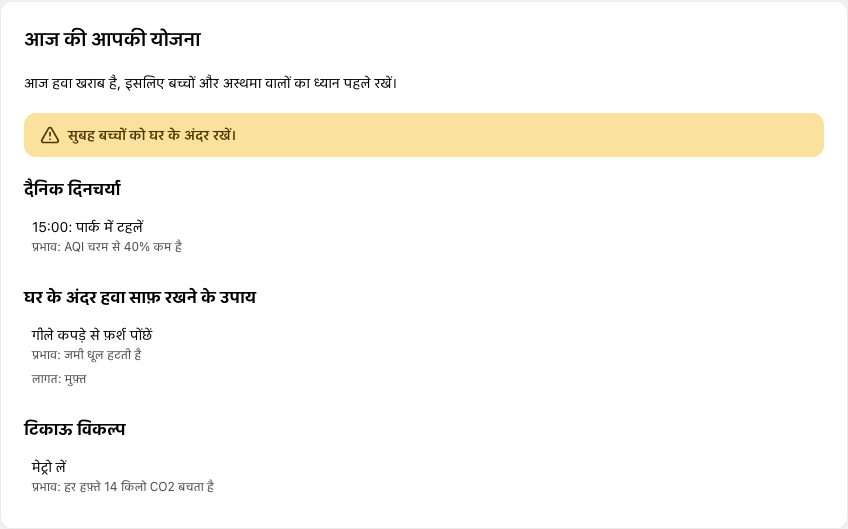
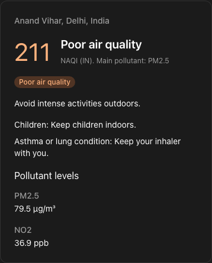

# SmogWise

[](https://github.com/Ritesh-Root/smogwise/actions/workflows/ci.yml)
[](https://github.com/Ritesh-Root/smogwise/actions/workflows/codeql.yml)
[](LICENSE)

A GenAI assistant that helps families and communities get through severe winter smog and urban air pollution.

**Live app:** https://smogwise-295478535981.asia-south1.run.app



## Problem statement

> Create a GenAI-powered assistant that helps families and communities navigate severe winter smog and urban air pollution. The application should suggest low-emission daily routines, indoor air quality hacks, and sustainable alternatives tailored to their location and lifestyle, while clearly explaining the direct impact of their choices.

## How SmogWise answers it

| Requirement | What the app does |
| --- | --- |
| Tailored to location | Geocodes a typed place or the browser's location, then reads live conditions and a 24-hour forecast for that spot from the Google Air Quality API. India's CPCB index and the US EPA index are scored directly; any other country falls back to Google's Universal AQI. |
| Tailored to lifestyle | A short household profile: who lives there, commute mode and distance, cooking fuel, winter heating, purifier, free-text notes. The Air Quality API's health advice for the groups in the household (children, older adults, lung conditions, pregnancy, outdoor work) is shown and given to the model. |
| Low-emission daily routines | Gemini builds a time-ordered routine that starts from the current local time and is scheduled around the cleanest and dirtiest forecast hours. |
| Indoor air quality hacks | Tips matched to the household's fuel, heating and purifier, each with a rough cost in the local currency. |
| Sustainable alternatives | Swaps for current habits, such as a cleaner commute or heating source. |
| Direct impact of choices | A deterministic engine computes the commute's weekly CO2 and PM2.5, what each cleaner mode saves (CO2 and PM2.5, weekly and yearly), and how much cleaner the best daytime hour is. Every routine, tip and swap also carries an impact line written by the model. |
| Families and communities | Plain-language output in English or Hindi, a "copy plan to share" button for group chats, and a follow-up chat. |

<p>
  
  
</p>
<p>
  
  
</p>
<p>
  
  
</p>

## How it works

```
Browser: React 19 + Astryx design system (built with Vite, results and chat loaded on demand)
   |  GET /api/location   POST /api/plan   POST /api/chat
   v
Express on Cloud Run (serves the built client and the API)
   |-- Geocoding API ............ place name <-> coordinates
   |-- Air Quality API .......... current conditions, health advice, hourly forecast
   |-- impact engine ............ commute emissions, best/worst hours, severity (pure functions)
   `-- Gemini on Vertex AI ...... structured JSON plan and chat
```

1. The server validates the request, then gathers facts: place, air quality, forecast, and the impact maths.
2. Those facts go to Gemini as its source of truth, with a response schema for the plan.
3. The model's JSON is validated again on the server before it reaches the browser.

**What the model does and does not do.** The server computes the commute emissions, the savings, the best and worst hours and the severity. The model is told to quote them exactly and not to invent measurements. It also writes costs, tips and the impact lines for routine items, and those are its own estimates: the app does not machine-check numbers inside the model's sentences. The figures in the "impact of your choices" card are always the server's.

## API

| Method and path | Body or query | Success | Errors |
| --- | --- | --- | --- |
| `GET /api/location` | `q` (place name) or `lat` and `lng` (plain decimals) | `{lat, lng, label}` | 400 invalid, 404 not found |
| `POST /api/plan` | `{lat, lng, label, utcOffsetMinutes, profile}` | `{location, air, impact, groupAdvice, plan}` | 400, 429, 502, 503 |
| `POST /api/chat` | the plan body plus `question` and up to 6 `history` turns | `{answer}` | 400, 429, 502, 503 |
| `GET /health` | | `{status: "ok"}` | |

Errors are always `{ "error": "message" }` with a message that is safe to show. Unexpected faults return 500; failures of Google services return 502.

## Google services

| Service | Use |
| --- | --- |
| Gemini 3.8 Flash on Vertex AI (`@google/genai`) | Plan generation with structured output and safety settings, and the follow-up chat |
| Air Quality API | Live local AQI, pollutant concentrations, health advice by group (in English or Hindi), 24-hour forecast |
| Geocoding API | Place search and reverse geocoding |
| Cloud Run | Hosting, scale to zero |
| Cloud Build and Artifact Registry | Container build from the Dockerfile |
| Secret Manager | Maps API key, mounted at runtime |
| IAM | Dedicated service account; Gemini is called with its identity, so there is no model API key |
| Cloud Logging | Structured JSON logs |

## Security

- Strict Content Security Policy (no `unsafe-inline`; `script-src-attr 'none'`), HSTS, `nosniff`, `X-Frame-Options: DENY` and a Permissions-Policy, via Helmet. Styles are `'self'` only, with one exception: the design system injects a single `<style>` element for popover animations, and that exact content is allowed by SHA-256 hash. The design system is pinned to an exact version for this reason. Real-browser tests check that no CSP violations occur.
- Every request is validated with zod: strict objects, enums, numeric ranges and length limits. Coordinates must be real numbers (query strings must be plain decimals), control characters are stripped from free text, and the body is capped at 32 kB.
- **Cost controls.** Each client may make 30 API requests a minute but only 10 to the two routes that call Gemini; each instance allows 600 model calls an hour; the Gemini call has a 30 s timeout; and Cloud Run is capped at 3 instances. Together that bounds spend even if limits are bypassed. Set a billing budget alert on the project as well.
- **Prompt injection.** The place name, the notes, and every chat turn, including earlier "model" turns (which the browser supplies), are treated as untrusted data in the instructions. The model is limited to air quality topics and its plan must match a schema, but prompt injection cannot be ruled out entirely. Nothing is stored or shared between users, so a successful injection only affects the attacker's own session.
- Model output is shown as React text or Markdown rendered by the design system, never as raw HTML. External images are blocked by the CSP.
- No secrets in the repository. The Maps key is held in Secret Manager and sent in a request header, not a URL. Restricting it to the Air Quality and Geocoding APIs is done in Google Cloud (see Deploy).
- Upstream error details are logged with a stack trace, never returned to the client.
- The container runs as a non-root user with production dependencies only; the client toolchain stays in the build stage.
- CI pins its actions by commit SHA and runs CodeQL, `npm audit` and `npm audit signatures`; Dependabot keeps npm, Actions and the base image current. Production dependencies have no known vulnerabilities. One advisory (`picomatch`, a ReDoS in glob matching) affects only dev tooling (Vite, Vitest), has no patched release yet, and does not ship in the container.

## Privacy

- "Use my location" rounds coordinates to about 1 km before they leave the browser, so precise positions never appear in request URLs or Cloud Run logs.
- Only the place name is sent to Gemini, not coordinates. Request bodies are not logged; log lines carry the method, path and error.

## Efficiency

- Air quality is cached per ~1 km grid cell and language for 10 minutes, geocoding for 24 hours, and concurrent identical lookups share one upstream request. Current conditions and forecast are fetched in parallel.
- The model context is trimmed to the fields it needs and thinking is set to low. Measured end to end on `gemini-3.8-flash` (six real requests, English and Hindi): a plan takes about 9 s (median 9.3 s; the slowest call took 24 s) and a chat answer about 3 s. A model attempt that times out after 25 s is retried once.
- Hashed client assets are served with a one-year immutable cache; the HTML always revalidates. Responses are compressed on the fly (Brotli or gzip).
- The results and the chat (with its Markdown renderer) are code-split, so the first screen only loads the form. First load is about 290 kB over the wire, most of it React and the design system. That is the cost of a full component library compared with a hand-written page.

## Accessibility

- Built on Astryx components, which ship keyboard support and ARIA wiring, with the form patterns from Chrome's Modern Web Guidance: errors shown on blur or submit and cleared on input, `aria-invalid` kept in sync, and focus moved to the first invalid field once the errors are on screen.
- Semantic landmarks, one `h1`, ordered headings, a skip link, and a label on every control. Focus moves to the plan when it appears, with a visible focus ring. Failures are announced as alerts; progress and results use a polite live region.
- The plan card is entirely in the plan's language (headings included) and carries that `lang`; model text elsewhere, such as Hindi chat answers and Hindi health advice, is marked too, and the Hindi option is labelled `lang="hi"`.
- Severity is given in words as well as colour. The forecast chart is one image with a text summary, and the same data is available as a table. Control borders meet 3:1 contrast.
- Light and dark themes follow the system setting; forced-colors and reduced-motion are respected; the layout reflows to 320 px without sideways scrolling.
- Verified by `npm run e2e`: axe-core (WCAG 2.0 to 2.2 AA, colour contrast included) in real Chromium on desktop in light mode, a 375 px phone in dark mode and a 320 px phone, on both the form and the results.

## Testing

```bash
npm install
npm run check     # lint, type check, API tests, UI tests, production build, browser tests
```

- `npm test`: 86 API tests on Node's built-in runner with no network access. They cover the impact maths, cache, validation, config, the Google service clients (fake `fetch`, fake model), prompts, plan schemas, every route, security headers, rate limits and the cost budget, error mapping and logging. Coverage is enforced at 95% of lines and stands at 100%.
- `npm run test:web`: 56 UI tests on Vitest and Testing Library, covering form validation and focus, the full plan flow, failures, geolocation, copy-to-share, Hindi, the chat and its retry behaviour, the error boundary, the API client, and an axe scan of the form and results. Coverage thresholds are enforced (about 98% of lines today).
- `npm run e2e`: 11 Playwright tests in real Chromium against the real server and built client with fixed fake data in place of Google, covering accessibility, CSP violations, keyboard use, the plan and chat, Hindi, the forecast table and the response headers.
- `npm run typecheck`: `tsc` in strict mode over the server, using JSDoc types (`src/types.js`).
- GitHub Actions runs all of this, plus a Docker build, on every push and pull request.

## Run locally

Requires Node 22 or newer, a Google Cloud project with Vertex AI enabled, and an API key for the Air Quality and Geocoding APIs.

```bash
cp .env.example .env              # then fill in the values
gcloud auth application-default login
npm install
npm run build && npm start        # http://localhost:8080
```

For UI work, run `npm run dev` in one terminal and `npm run dev:web` in another; Vite proxies `/api` to the server. Settings are validated at startup (`src/config.js`); the optional ones are `GEMINI_MODEL` (default `gemini-3.8-flash`), `VERTEX_LOCATION` and `PORT`.

## Deploy

```bash
gcloud run deploy smogwise --source . --region asia-south1 \
  --service-account smogwise-runtime@$PROJECT.iam.gserviceaccount.com \
  --set-secrets MAPS_API_KEY=smogwise-maps-key:latest \
  --set-env-vars GOOGLE_CLOUD_PROJECT=$PROJECT \
  --max-instances 3 --allow-unauthenticated
```

One-time setup in Google Cloud: enable the Vertex AI, Air Quality, Geocoding, Secret Manager and Cloud Run APIs; create an API key restricted to the Air Quality and Geocoding APIs and store it in the `smogwise-maps-key` secret; create the `smogwise-runtime` service account with `roles/aiplatform.user` on the project and `roles/secretmanager.secretAccessor` on the secret; and add a billing budget alert.

## Project layout

```
server.js                entry point: loads config, wires real Google clients into the app
src/app.js               composes the Express app
src/routes/api.js        the three API routes
src/middleware/          security headers, rate limits and cost budget, error handler
src/context.js           gathers air, impact and advice for one household
src/engine/impact.js     deterministic impact maths
src/validation.js        zod schemas for requests; src/plan.js holds the plan schemas
src/prompt.js            system instruction and the facts given to the model
src/services/            Air Quality, Geocoding and Gemini clients, and the TTL cache
src/shared/options.js    choices and labels used by both the server and the form
src/constants.js         limits and timings, also used by the form
web/                     React client: App, components/, hooks/, API client, formatting
test/                    API tests (node:test), mirroring src/
web/test/                UI tests (Vitest)
e2e/                     browser tests (Playwright) and the fake-data server they use
```

## Assumptions and limits

- **Emission factors are planning estimates.** The per-kilometre figures in `src/shared/options.js` are rounded fleet-average values for Indian city traffic, chosen for comparing options. They are not drawn from a single cited dataset and are not for reporting. The "carpool" figure assumes three people.
- **Indoor impacts are qualitative.** The engine quantifies the commute and the best outdoor hour only. Effects of cooking fuel, heating and purifiers are described by the model without computed numbers.
- **Time zone.** Forecast hours and the "current time" given to the model use the browser's time zone, which is wrong if someone plans for a place in another zone.
- **India-first.** Commute modes, emission factors and the Hindi option are designed for Indian cities. Other places work through the Universal AQI, but advice is less specific.
- **Cold starts and caches.** The app scales to zero, and its caches are per instance, so the first request after a quiet period is slower.
- Guidance is general wellbeing advice, not medical advice.

## Credits

- UI built with [Astryx](https://github.com/meta/astryx), Meta's design system.
- Frontend practices guided by Chrome's [Modern Web Guidance](https://github.com/GoogleChrome/modern-web-guidance).
